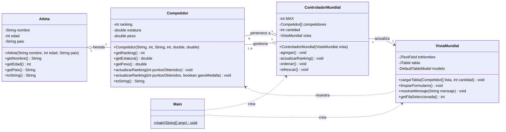
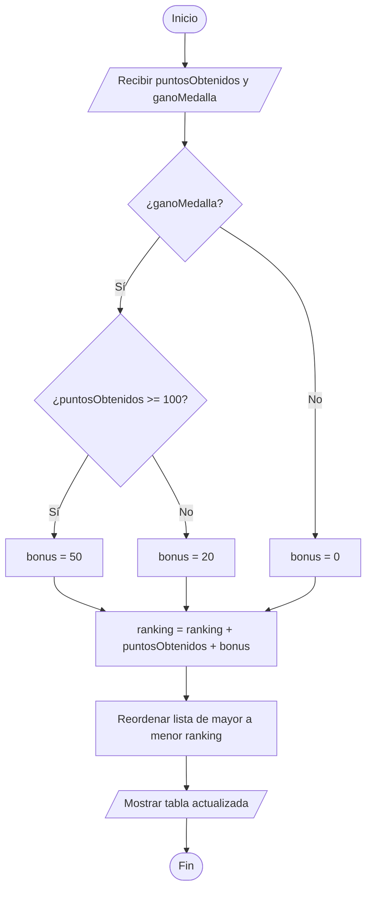

# sistema-mundial-de-ciclismo

Aplicación de escritorio para registrar competidores de un mundial deportivo, mostrarlos en un ranking y actualizar su puntaje. Está desarrollada con **Java 26**, **Swing/JFrame** y **Maven** (NetBeans 30), sin librerías externas. El ejercicio no requiere manejo de fechas, por eso no se usa clase `Fecha`.

## Requisitos

- JDK 26
- Apache NetBeans 30 (o cualquier IDE compatible con Maven)
- Maven (incluido en NetBeans)

## Estructura del proyecto

```
src/main/java/
├── modelo/
│   ├── Atleta.java               (superclase)
│   └── Competidor.java           (subclase)
├── vista/
│   └── VistaMundial.java         (JFrame)
├── controlador/
│   └── ControladorMundial.java
└── Main.java                     (clase principal)
```

## Patrón MVC

| Capa | Clase | Responsabilidad |
|------|-------|-----------------|
| Modelo | `Atleta`, `Competidor` | Datos y reglas de negocio (incluye el cálculo del ranking). |
| Vista | `VistaMundial` | Interfaz gráfica (formulario, tabla y botones). No contiene lógica de negocio. |
| Controlador | `ControladorMundial` | Valida los datos, administra el arreglo de competidores y conecta la vista con el modelo. |
| Principal | `Main` | Crea la vista y el controlador e inicia la aplicación. |

La vista no conoce al controlador: el controlador se registra como oyente de los botones de la vista.

## Descripción de las clases

- **`Atleta`**: datos básicos: `nombre`, `edad`, `pais`.
- **`Competidor extends Atleta`**: agrega `ranking` (puntaje acumulado), `estatura` (m) y `peso` (kg).
- **`ControladorMundial`**: mantiene un arreglo `Competidor[]` (máximo 50) con un contador. Ordena de mayor a menor ranking con el método burbuja y refresca la tabla.
- **`VistaMundial`**: formulario de registro, tabla de solo lectura y panel para actualizar el ranking del competidor seleccionado.

## Conceptos de POO aplicados

- **Herencia**: `Competidor` hereda de `Atleta` y reutiliza sus atributos y métodos.
- **Sobreescritura (Override)**: `Competidor.toString()` usa `super.toString()` para concatenar los datos de la superclase con los propios. Además, en la vista se sobreescribe `isCellEditable` de `DefaultTableModel` (clase anónima) para que la tabla sea de solo lectura, de modo que el ranking solo cambie por las reglas del modelo y mediante el controlador, con validación.
- **Sobrecarga (Overload)** en `Competidor`:
  1. `actualizarRanking(int puntosObtenidos)`: suma los puntos al ranking.
  2. `actualizarRanking(int puntosObtenidos, boolean ganoMedalla)`: aplica una bonificación mediante una estructura condicional **anidada**.
- **Encapsulamiento**: atributos privados con getters públicos.

### Regla de bonificación (método sobrecargado)

| ¿Ganó medalla? | ¿Puntos ≥ 100? | Bonus |
|:-:|:-:|:-:|
| Sí | Sí | +50 |
| Sí | No | +20 |
| No | — | 0 |

`ranking = ranking + puntosObtenidos + bonus`

- Los valores de bonificación (umbral de 100 puntos y bonus de 50 / 20 / 0)

## Diagrama de clases (UML)



**Relaciones y cardinalidades**

- **Herencia (`Atleta` ← `Competidor`)**: un `Competidor` es exactamente un `Atleta` (1..1).
- **Agregación (`ControladorMundial` ◇— `Competidor`)**: el controlador gestiona de 1 a N competidores (1..N). Es agregación porque los competidores tienen vida propia. En el código es el arreglo `Competidor[]`.
- **N..1**: muchos `Competidor` pertenecen a un solo `ControladorMundial`.
- **Asociación `ControladorMundial → VistaMundial` (1..1)**: un controlador usa exactamente una vista.

## Diagrama de flujo: `actualizarRanking(puntosObtenidos, ganoMedalla)`



Los dos últimos pasos antes del fin (reordenar y mostrar) los ejecuta el controlador; el cálculo del bonus y del ranking está en `Competidor`.

## Uso de la aplicación

1. **Registrar**: llenar nombre, edad, país, ranking inicial, estatura (m) y peso (kg), y pulsar **Agregar**. Los decimales se escriben con punto (`1.75`).
2. **Ver ranking**: la tabla se ordena automáticamente de mayor a menor ranking.
3. **Actualizar**: seleccionar un competidor en la tabla, escribir los puntos obtenidos, marcar *Ganó medalla* si aplica y pulsar **Actualizar ranking**.
4. **Limpiar**: borra los campos del formulario.

## Validaciones

- Nombre y país obligatorios.
- Edad, estatura y peso mayores que 0; ranking y puntos no negativos.
- Campos numéricos con formato válido (se informa con un mensaje al usuario).
- Máximo de 50 competidores.
